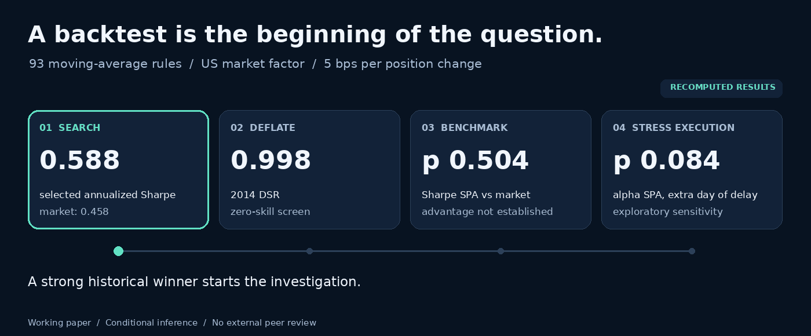

# Backtest overfitting, under cross-examination

**When a backtest looks strong, what does the evidence actually establish?**

A reproducible replication and empirical stress test of **PSR, DSR and CSCV/PBO**, with controlled simulations, real-data bootstraps and a 93-rule moving-average case study.

[](https://github.com/Executioner-Cs/pbo-explained/actions/workflows/tests.yml)
**Python 3.13 · MIT code licence · Working paper · External peer review outstanding**

### Read the research

| Start here | What you get |
|---|---|
| **[Full working paper](docs/working-paper.pdf)** | The complete study: methods, results, limitations, references and correction history. **34 pages.** |
| **[One-page research brief](docs/research-brief.pdf)** | The question, principal findings and caveats in a quick read. Suitable as a LinkedIn attachment. |
| **[Reproduce the results](docs/reproducibility.md)** | Exact input hashes, environment, seeds, commands and expected outputs. |

**One paper. One brief.** Both live in [`docs/`](docs/), the single home for public documents. The brief summarizes the paper; it is not another manuscript version. LaTeX, bibliography and figure sources are in [`docs/source/`](docs/source/).



*Animation: a map of the actual case-study checks, built from saved results. It is not a simulation or a claim that the tests have identical null hypotheses. [Static overview](assets/readme/research-overview.png).*

---

## The puzzle

Search 93 moving-average settings over about 54 years of US market-factor data. At a cost of 5 basis points per position change, the selected rule has:

- Annualized Sharpe **0.588**, versus **0.458** for the market.
- A zero-skill **DSR of 0.998**.
- **PBO of 0.208** across the specified CSCV splits.

Those numbers invite different interpretations. A zero-skill screening score, rank stability within a candidate set, a comparison of standalone Sharpe ratios and a regression alpha each answer a different question.

The study follows those distinctions through the actual calculations, including checks that weaken the apparent result.

## What the study found

All numerical findings here are **RECOMPUTED** from the supplied scripts and saved outputs. They are conditional on the stated designs.

| Question | Evidence | What it supports |
|---|---|---|
| Does the selected rule have an established standalone Sharpe advantage? | Sharpe SPA **p = 0.504**; no rule passes the 93-rule Bonferroni test. | The historical Sharpe advantage is not statistically established by these tests. |
| Is its positive alpha robust to the reported choices? | Baseline post hoc alpha SPA ranges from **0.035 to 0.065** across bootstrap choices. One extra execution day gives **p = 0.084**, Monte Carlo s.e. **0.0062**. | Exploratory, execution-sensitive evidence; no implementable edge is established. |
| Does nominal PSR size survive serial dependence? | Under zero-mean AR(1), phi = 0.3, uncorrected PSR passes **11.85%** of datasets against a nominal 5%. | The known IID-variance problem matters in this design. |
| Does the historical period matter? | Period-centered industry bootstraps give **8.35%** in 1971–1998 and **3.85%** in 1999–2026. | Only the early excess survives the stated eight-row Holm adjustment. The late shortfall is suggestive. |
| Is the operational 2014 DSR a calibrated 5% familywise test? | Independent zero-skill searches pass its 0.95 hurdle far less often than 5%. | Strong conservatism in the studied designs; the label is not an error-rate guarantee. |

The uncertainty intervals, precise nulls, post hoc choices and numerical details are in the paper. Bootstrap intervals measure Monte Carlo uncertainty conditional on the observed histories; they do not establish stationarity or external validity.

## The methods, without mixing up their questions

| Method | What it evaluates | Keep in mind |
|---|---|---|
| **PSR** — probabilistic Sharpe ratio | One strategy's estimated Sharpe against a chosen hurdle. | An asymptotic score under a variance model, not a posterior probability of skill. |
| **MinTRL** — minimum track record length | The sample length implied by that Sharpe hurdle and confidence convention. | Depends on the same assumptions. |
| **DSR** — deflated Sharpe ratio | A selected Sharpe against an expected-best-noise benchmark. | This study evaluates the **operational 2014 construction**, not all later formulations. |
| **MinBTL** — minimum backtest length | An expected-noise hurdle for a search size and target Sharpe. | Not a guarantee of test power or future performance. |
| **CSCV / PBO** | How often an in-sample winner ranks at or below the median out of sample across specified splits. | A candidate-set rank quantity; not a direct future-failure probability. |
| **HAC, Bonferroni and SPA** | Benchmark-relative inference allowing for stated dependence and search choices. | Their assumptions and the choice of endpoint still matter. |

In particular, **Sharpe(strategy − market)**, **Sharpe(strategy) − Sharpe(market)** and **market alpha** are different estimands. The case study reports them separately.

## Follow the evidence

The experiments build the argument in four stages:

1. **Replicate published examples.** Check formulas, conventions and selected printed values against page-level provenance.
2. **Construct known nulls.** Measure operating characteristics under IID, AR(1), GARCH, heavy tails and cross-strategy correlation.
3. **Resample real dependence.** Create zero-mean industry bootstrap populations, with each subperiod centered separately.
4. **Challenge a search winner.** Examine benchmark choice, selection-aware inference, costs, execution delay, signal construction and a retrospective walk-forward selector.

Useful inspection routes:

- [Claim → code → output](docs/evidence.md)
- [Research methods](docs/methods/research-design.md)
- [Data identity and acquisition](docs/data-manifest.md)
- [Source-paper value checks](docs/paper-checks.md)
- [Literature and access record](docs/literature-review.md)
- [Verification actually performed](docs/verification.md)
- [Limitations and open research](docs/limitations.md)

## Run the code

You can read both PDFs without installing anything. To run the Python work, use **Python 3.13** from the repository root.

### Linux / macOS

```bash
python3.13 -m venv .venv
.venv/bin/python -m pip install -r requirements.txt
.venv/bin/python -m pytest -q
```

### Windows PowerShell

```powershell
py -3.13 -m venv .venv
.\.venv\Scripts\python.exe -m pip install -r requirements.txt
.\.venv\Scripts\python.exe -m pytest -q
```

The complete local suite passes **296 tests with both frozen data archives present**. CI without those ignored archives skips two frozen-data checks. A green badge verifies the deterministic test suite under its displayed scope; it does not reproduce the empirical experiments.

### Reproduce one result

```bash
.venv/bin/python experiments/calibration.py
```

Each experiment writes its current output in `results/`. Use a separate checkout when comparing regenerated outputs with the saved evidence. The [reproduction guide](docs/reproducibility.md) gives the full sequence and the required frozen-data hashes.

For the added delayed-execution alpha check:

```bash
.venv/bin/python experiments/delayed_alpha.py
```

Its [pre-run sensitivity design](docs/methods/delayed-alpha-design.md), [complete 93-rule table](results/delayed_alpha.txt) and [raw bootstrap vectors](results/delayed_alpha_bootstrap.npz) are supplied. It is explicitly post hoc.

### Build the paper or animation

```bash
# Rebuild the seven paper figures from saved results.
.venv/bin/python experiments/build_paper_figures.py

# Requires Tectonic on PATH; writes the two PDFs into docs/ and logs into .local/build/.
.venv/bin/python scripts/build_paper.py

# Rebuild this README's animated and static overview from saved results.
.venv/bin/python scripts/build_readme_assets.py
```

No third-party paper PDFs or input data archives are redistributed. The real-data loader verifies SHA-256 and refuses a different snapshot. Acquisition commands and known toolchain limits are documented in the reproduction guide.

## Where everything lives

```text
src/pbo/               Statistical library; no experiment orchestration
tests/                 Deterministic checks, paper values and independent closed forms
experiments/           Fixed-seed analyses and figure generation
results/               Current saved numerical outputs and raw sensitivity evidence
docs/                  Working paper, brief, checksums and all supporting documentation
  methods/             Research design, CSCV and PSR/DSR conventions, sensitivity design
  source/              LaTeX, bibliography and generated vector figures
assets/readme/         Animated overview and its static alternative
scripts/               Paper and README asset builders
PROGRESS.md            Concise current research state and correction summary
```

There is no second “final” manuscript to choose between. Earlier drafts, superseded result copies and historical sign-offs remain in Git history. The [documentation index](docs/README.md) provides the deeper reading routes.

<details>
<summary><strong>Scientific scope and correction history</strong></summary>

This is a replication and conditional empirical stress test. It proposes no new statistic and establishes no implementable trading strategy or future-performance guarantee.

The original globally centered G6 subperiod analysis was withdrawn. Corrected runs center each period. The Holm interpretation, walk-forward cost accounting, active-return DSR wording and finite-input SPA validation were corrected. Negative and execution-sensitive results are reported. The paper's correction appendix and Git history retain the record.

Important limitations include retrospective endpoint and analysis choices, limited multiplicity families, one vendor/market/rule family, idealized execution, unverified stationarity and bootstrap assumptions, untested modern DSR variants, and untagged PDF accessibility. The internal review does not replace external human technical review.

</details>

## Credit and licence

The study builds on published work by David H. Bailey, Jonathan Borwein, Marcos López de Prado, Qiji Jim Zhu and the Sharpe-inference, bootstrap and data-snooping literature. Existing theoretical results are credited separately from the empirical extensions. See the [paper bibliography](docs/source/references.bib) and [literature inventory](docs/literature-review.md).

**Code:** [MIT](LICENSE). **Input data:** Kenneth R. French Data Library; not covered by the code licence and not redistributed. **Research status:** working paper; external peer review outstanding.
