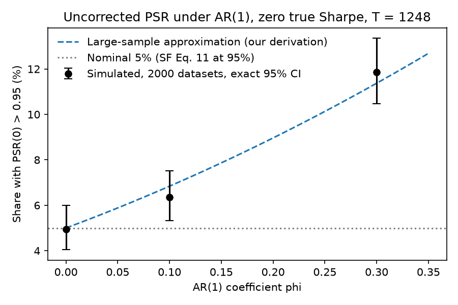

# What backtest-overfitting statistics measure: a replication

Step 6 write-up, reviewed 2026-11-12 (TODO 6.5). Labels: PAPER = printed in a paper (page given); RECOMPUTED = produced by this repository (file
given); UNVERIFIED = not checked by code or by a page. Our modeling choices are marked "(our choice)".

Papers (docs/paper_values.md): PBO = "The Probability of Backtest Overfitting"; SF = "The Sharpe Ratio Efficient
Frontier"; DSR = "The Deflated Sharpe Ratio"; PSEUDO = "Pseudo-Mathematics and Financial Charlatanism". All by
Bailey, Lopez de Prado and, for PBO and PSEUDO, Borwein and Zhu.

## 1. Question
What do these methods measure about backtest selection and statistical confidence, and what limitations appear in
our experiments? They answer different questions; none directly certifies a real edge.

| Tool | Source | Question it answers |
|---|---|---|
| PBO (via CSCV) | PBO paper | How often does the in-sample winner of a set of strategies rank at or below the out-of-sample median? |
| PSR | SF Eq. 11 | How confident are we that one strategy's Sharpe exceeds a benchmark SR*, given skew and kurtosis? |
| DSR | DSR Eq. 2 | PSR for the best of N trials, against SR0, the Sharpe the best of N zero-skill trials is expected to reach. |
| MinTRL | SF Eq. 13 | Sample-length tool: how long a track record PSR needs for a given confidence. |
| MinBTL | PSEUDO Eq. 3.2 | Sample-length tool: relates the number of trials N, the sample length and the expected best Sharpe from noise alone. |

Sections 3-4 test the three statistics (PBO, PSR, DSR). MinTRL is checked against the paper examples. MinBTL is
checked against the paper examples, and its expected-maximum approximation against simulation (Section 3.1).

## 2. Method
- Formulas coded from the papers, each constant with its page (src/pbo/paper_values.py). A page-by-page check of all
  52 constants: 45 match, 0 mismatch, 7 derived (docs/paper_check.md).
- Numerical expectations come from paper examples or independently derived closed forms. Additional tests
  check input validation, invariants and experiment reporting. Full suite: 224 tests pass (RECOMPUTED, 2026-11-12).
- Every experiment design and prediction was written down before its run; from step 5 on, committed before the run.
- Modeling choices (ours, not the papers'):
  - PBO counts logit <= 0 (our reading of PBO Sec. 3.1, p.13; Def. 2.2 on p.10 uses rank < N/2). Under the null the
    reference is 0.5 for N = 100 and 25/49 for N = 49. Ties take average ranks.
  - Sharpe ratios use ddof 0; the variance V of trial Sharpes in DSR uses ddof 1.
  - Implied N (DSR Eq. 8-9) clamps a negative average correlation at 0.
  - Newey-West lags int(4 (T/100)^(2/9)): 7 at T = 1248, 11 at T = 13,664.
  - Block lengths, simulation levels, the step 5 grid and costs are listed where used.

## 3. Results

### 3.1 Replication of the paper examples
All printed examples are reproduced to the printed precision (RECOMPUTED, tests/):

| Example | Paper value |
|---|---|
| PSR(0), hedge fund, Normal / skew and kurtosis / 3 years | 0.982 / 0.913 / 0.953 (PAPER, SF pp.9-10) |
| MinTRL, SR 2 vs SR* 1, daily / weekly / monthly / monthly HFR | 2.73 / 2.83 / 3.24 / 4.99 years (PAPER, SF p.11) |
| DSR, SR 2.5, N = 100 / N = 46 | 0.9004 / 0.9505 (PAPER, DSR p.10); SR0 0.1132 (PAPER, DSR p.10) |
| Expected maximum of N = 10 standard Normals | 1.57 (PAPER, PSEUDO p.9) |
| MinBTL, target Sharpe 1, 5 years | at most 45 configurations (PAPER, PSEUDO p.11) |

Simulation check of the expected maximum (RECOMPUTED, results/best_of_n.txt; 2000 trials, 5 years daily, zero
edge): for the best of N = 10 five-year annual Sharpe estimates, PSEUDO Eq. 2.4 times 5^(-1/2) gives 0.704; the
simulated mean is 0.688 +/- 0.006. The gap is similar at N = 45 (1.000 vs 0.984 +/- 0.005) and N = 100 (1.132 vs
1.119 +/- 0.004).

One printing error: PBO pp.11 and 22 print 12,780 splits for S = 16; Eq. 2.3 gives C(16, 8) = 12,870.

### 3.2 Selection: PSR vs DSR on the best of 100 zero-edge strategies
Five years daily, 2000 trials (RECOMPUTED, results/dsr_false_positives.txt):
- PSR(0) > 0.95 on the best: 99.15% [98.6, 99.5]. PSR ignores the selection.
- DSR > 0.95 on the best: 0.05% [0, 0.28]. DSR accounts for it, and in this setup is far below 5%.

### 3.3 Broken assumptions, zero true edge (synthetic)
N = 100 strategies, T = 1248 days, seed 20261110 (RECOMPUTED, results/calibration.txt). PSR and DSR: 2000 datasets
per scenario, rates with exact 95% CIs in percent. PBO: 200 datasets, mean +/- one Monte Carlo SE. A count of 0
gives a rate of 0% in this sample, not a zero underlying rate; its CI shows the range.

| Scenario | PSR(0) > 0.95, fixed strategy | DSR > 0.95, best, N = 100 | Mean PBO |
|---|---|---|---|
| IID Normal | 4.95 [4.04, 5.99] | 0.00 [0.00, 0.18] | 0.520 +/- 0.010 |
| AR(1) phi 0.1 | 6.35 [5.32, 7.51] | 0.10 [0.01, 0.36] | 0.495 +/- 0.010 |
| AR(1) phi 0.3 | 11.85 [10.47, 13.35] | 0.70 [0.38, 1.17] | 0.482 +/- 0.011 |
| GARCH (0.05, 0.90) | 4.70 [3.81, 5.72] | 0.15 [0.03, 0.44] | 0.481 +/- 0.011 |
| GARCH (0.10, 0.85) | 5.45 [4.50, 6.54] | 0.10 [0.01, 0.36] | 0.501 +/- 0.011 |
| Student-t nu 8 | 4.35 [3.50, 5.34] | 0.15 [0.03, 0.44] | 0.511 +/- 0.011 |
| Student-t nu 5 | 4.85 [3.95, 5.88] | 0.05 [0.00, 0.28] | 0.504 +/- 0.011 |
| Correlated rho 0.3 | 5.35 [4.40, 6.43] | 0.70 [0.38, 1.17]; implied N 1.05 [0.65, 1.60] | 0.512 +/- 0.011 |
| Correlated rho 0.7 | 4.95 [4.04, 5.99] | 2.60 [1.95, 3.40]; implied N 5.05 [4.13, 6.10] | 0.504 +/- 0.011 |

- Among the tested scenarios, the AR(1) cases show a detected increase in PSR rejection rates; every other PSR
  interval contains 5%. For a stationary Gaussian AR(1) at zero Sharpe our derivation gives the large-sample rate:
  6.84% at phi 0.1, 11.37% at phi 0.3 (RECOMPUTED, psr_dsr.ar1_psr_false_positive). Both values lie inside the
  simulated 95% intervals (Figure 1).
- The DSR rate rises with correlation between strategies. Mean PBO stays within about 2 SE of 0.5 in every scenario.
- A Newey-West variance (our correction) cuts PSR at phi 0.3 from 11.85% to 7.10% [6.01, 8.31], not to 5%.
- PBO with one real edge (T = 992, 20 datasets per cell; RECOMPUTED, results/null_checks.txt): no reduction in power
  was detected at the tested GARCH level. Under AR(1) phi 0.3 mean PBO is higher than under IID noise, so the real
  edge is detected less well: 0.391 +/- 0.043 vs 0.189 +/- 0.037 at annual Sharpe 2 (z +3.55), 0.098 +/- 0.019 vs
  0.026 +/- 0.007 at Sharpe 3 (z +3.62).

Figure 1 (results/figure1_psr_ar1.png, made by experiments/figure_psr_ar1.py): uncorrected PSR(0) > 0.95 rate at
the tested AR(1) values (IID baseline, phi 0.1, 0.3), 2000 simulated datasets each, exact 95% intervals
(RECOMPUTED, results/calibration.txt). Dashed line: large-sample rate from our derivation, an asymptotic
approximation, not a simulation (RECOMPUTED, results/psr_ar1_curve.txt). Dotted line: nominal 5%.

### 3.4 The serial-correlation claim
SF p.4 says, citing Opdyke (2007), that its results hold for stationary and ergodic returns (PAPER, SF p.4; also p.8).
Section 3.3 contradicts this for a stationary AR(1). At zero true Sharpe, stationary Gaussian AR(1) dependence
changes the limiting variance by (1 + phi)/(1 - phi); the discrepancy persists as the sample grows (our derivation).
The claim traces to Opdyke's reading of Christie's (2005) lag-0 closed form (Christie App. B, pp.33-35; Opdyke p.4).
It is not a new finding: Ledoit and Wolf (2008), January 2008 working paper, printed p.6, Remark 3.1, already call
Opdyke's formulas for stationary time series incorrect (PAPER; checked by online text inspection, not in papers/).
SF's IID results, examples and formulas stand.

### 3.5 Real dependence: French 49 industries
Daily value-weighted industry returns, 1971-07-01 to 2026-09-30, demeaned so the true edge is zero, resampled in
whole-day blocks of L days (our choice: L = 1, 5, 20, 60; L = 20 primary), T = 1248, 2000 datasets (RECOMPUTED,
results/french_bootstrap.txt, results/french_followups.txt):
- PSR(0) > 0.95: 5.35% [4.40, 6.43] at L = 1, 6.25% [5.23, 7.40] at L = 20 and at L = 60. Pooled over L >= 5: 5.88%, z = 3.14 (UNVERIFIED as code:
  one-off calculation from the counts; pooling chosen after the run).
- The excess depends on the period (L = 20): 10.45% [9.14, 11.87] when resampling 1971-1998 (mean daily lag-1
  autocorrelation +0.157) and 3.30% [2.56, 4.18] for 1999-2026 (mean -0.026).
- DSR rates are 1.25% to 3.55%, every upper CI bound below 5%; implied N is 23.0 to 23.3 for 49 industries. Mean PBO
  0.505 to 0.520 (SE 0.012 to 0.014; reference 25/49 = 0.510). PBO: 200 datasets per L.

### 3.6 Case study: moving-average crossover on the US market
93 settings (our choice: fast 5-50, slow 25-250 days), long the market or flat, signal acts the next day, costs 0, 5
(main) or 10 bps per change in position (our choice). Fama-French market factor, 1972-07-18 to 2026-09-30,
T = 13,664 days (RECOMPUTED, results/ma_crossover.txt, results/market_comparison.txt). At 5 bps:

| Measure | Value | What it says |
|---|---|---|
| Best setting (15/225) annual Sharpe vs market | 0.588 vs 0.458 | Historical, in-sample advantage of +0.130 |
| PBO (S = 16) | 0.208 | 20.8% of CSCV splits put the in-sample winner at or below the OOS median; fails the PBO <= 0.05 rule (PAPER, PBO p.14) |
| DSR, N = 93 / implied N 17.2 | 0.9980 / 0.9994 | Best Sharpe is above SR0, the zero-skill selection benchmark; not a test against the market |
| Paired HAC test vs market (11 lags) | difference 0.130, se 0.099, raw one-sided p 0.094 | Insufficient evidence of superiority; 0 of 93 pass the Bonferroni test (also at 0 and 44 lags) |

At 0 and 10 bps the best setting is the same and PBO is 0.240 and 0.193. The paired test follows Ledoit and Wolf
(2008), Eqs. 1-5, with a Bartlett kernel, fixed bandwidth and no T/(T-4) scaling (our choices). Conclusion: the
selected rule had a higher historical Sharpe than the market, but this does not establish that any of the 93
settings beats it, nor that timing skill is absent.

## 4. Limits

What the calibration showed breaks, within the tested scenarios:
- PSR's variance assumes no serial correlation. Under AR(1) its rejection rate exceeds 5% (Section 3.3), and on real
  industry returns the rate depends on the period (Section 3.5).
- A Newey-West variance with the rule-of-thumb lag reduces but does not remove the excess at phi 0.3 (7.10%).
- PBO keeps its null level near 0.5 in every scenario but detects a real edge less well under AR(1) phi 0.3.
- DSR's rate depends on correlation between strategies; with N = 100 it stays far below 5%, with implied N it
  reaches 5.05% at rho 0.7. Neither is a calibrated 5% test.

Scope of this study:
- PSR was tested only at SR* = 0; MinTRL under GARCH is untested. Synthetic levels are our choices, not a survey.
- Section 3.5 intervals are Monte Carlo error given one 1971-2026 history.
- DSR rates rest on reading DSR > 0.95 as 95% confidence (DSR p.10); no paper states a false-positive rate.
- PBO is a share of overlapping CSCV splits, not a future failure probability, and has no binomial standard error.
- The case study is one market, one strategy family and one grid. The HAC test is asymptotic; Bonferroni is
  conservative. HAC validity requires suitable stationarity, mixing, finite moments and bandwidth growth;
  those conditions are not established for this long market history. Not rejecting is not proof of no skill.
- All results are historical; none says how a strategy will perform in the future.

## Unresolved claims (TODO 6.6)
- Pooled PSR rate over L >= 5 (5.88%, z = 3.14, Section 3.5): UNVERIFIED as code. A one-off calculation from the
  counts, recomputed by hand in this review ((353/6000 - 0.05) / sqrt(0.05 x 0.95 / 6000) = 3.14); pooling was chosen
  after the run.
- Ledoit and Wolf (2008): checked by online text inspection of the working paper, not of the journal version, and
  not stored in papers/.

## 5. References
- Bailey, Borwein, Lopez de Prado, Zhu: PBO and PSEUDO; Bailey, Lopez de Prado: SF and DSR (docs/paper_values.md).
- Christie (2005), SSRN 720801. Opdyke (2007), Journal of Asset Management 8(5).
- Ledoit, O. and Wolf, M. (2008), Journal of Empirical Finance 15(5), 850-859, doi 10.1016/j.jempfin.2008.03.002.
